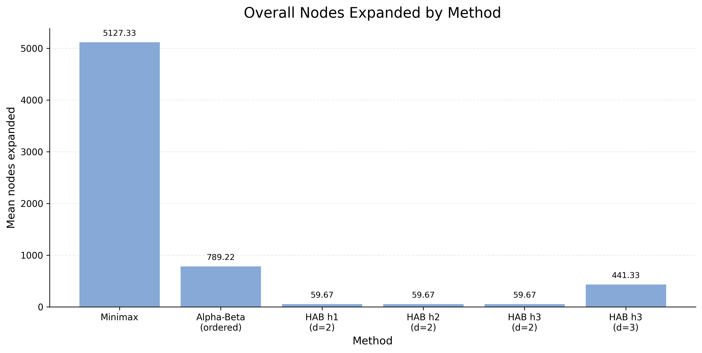

# AI for Merger Negotiation
### Search efficiency vs. decision quality

A Python simulation of bilateral merger bargaining, comparing Minimax, exact Alpha-Beta pruning, and depth-limited Alpha-Beta with three heuristic evaluation functions.

## Business question
How do computational constraints and evaluation design affect decisions in a sequential buyer–seller negotiation?

The model translates reservation values, synergy, concession budgets, delay costs, and negotiation deadlines into a finite-horizon search problem. The buyer maximizes and the seller minimizes a simplified relative payoff.

## What this project demonstrates
- Business problem formulation and explicit modeling assumptions.
- Python implementation of adversarial search and heuristic evaluation.
- Controlled experiments across nine synthetic scenarios: buyer-advantaged, balanced, and seller-advantaged.
- Comparison of computational effort, agreement outcomes, utility gaps, and move ordering.
- Reproducible CSV outputs and visual reporting.



## Results at a glance
The included outputs were regenerated from the revised code. Ordered exact Alpha-Beta visits 789.22 nodes on average versus 5,127.33 for Minimax (84.6% fewer mean visits), matching mean utility and final-status profile across nine scenarios.

At matched depth 3, h1/h2/h3 have identical mean realized utility (-13.333) and mean absolute deviation from Minimax (0.222). This batch does not demonstrate an outcome advantage for h3. Depth-2 self-play yields higher buyer scores, which does not establish stronger strategies against an exact opponent.

See [method-level results](outputs/negotiation_batch_summary_by_method.csv), [comparison with Minimax](outputs/negotiation_batch_summary_vs_minimax.csv), and the [revised technical report](reports/final-report.pdf).

Report tables and charts come from this revised run. Timing is a single measurement per scenario/method and is illustrative; reruns will differ. See [changes](CHANGELOG.md) for differences from the supplied academic version.

## Quick start
Run these commands from the repository root with Python 3.10 or later:

```bash
python -m venv .venv
# macOS / Linux
source .venv/bin/activate
# Windows PowerShell: .venv\Scripts\Activate.ps1
python -m pip install -r requirements.txt
python merger_negotiation_batch_experiments.py
python plot_negotiation_results.py
python -m unittest discover -s tests -v
```

The experiment script uses Python's standard library; plotting requires the packages in `requirements.txt`. For a headless environment, run plotting with `MPLBACKEND=Agg`.

## Repository guide

| Path | Purpose |
|---|---|
| `merger_negotiation_game.py` | State, rules, utility, heuristics, Minimax and Alpha-Beta |
| `merger_negotiation_batch_experiments.py` | Scenario configurations, benchmarks and CSV export |
| `plot_negotiation_results.py` | Charts and presentation tables from generated CSVs |
| `outputs/` | Regenerated benchmark data and figures |
| `reports/final-report.pdf` | Revised technical report |
| `tests/` | Exact-search agreement checks |

Keep the three Python scripts together: the batch script imports the game module, and both output scripts resolve paths relative to their own location.

## Assumptions and limitations
- Synthetic scenarios, not observed M&A transactions; no empirical validation is claimed.
- Deterministic, fully observable, turn-based bargaining with a finite horizon.
- Relative zero-sum approximation, not a full model of both parties' economic welfare.
- Default `asymmetric_relative` exit scoring can reward the buyer when the seller exits. Interpret utility as an adversarial model score, not financial profit.
- The alternative `symmetric_breakdown` mode changes results and should be evaluated separately; it remains a buyer-facing score in an adversarial model.
- A small scenario set and short horizons limit generalization.
- Equal optimal values need not imply identical actions when multiple moves tie.

This is a research simulation, not a production valuation or negotiation advisory tool.

## Further work
Broaden scenarios and horizons, repeat timing measurements, examine sensitivity to exit-payoff assumptions, and extend to incomplete information and separate buyer/seller utilities.

## Rebuild the report

```bash
python -m pip install -r requirements-report.txt
python scripts/build_report.py
```

## Validation and provenance
Six automated tests cover exact-search value agreement on scenario roots and immediate successors, incremental concession budgets for both parties, illegal acceptance, pressure-heuristic activation and invalid step size. CI runs the tests on Python 3.10 and 3.12. Source code and the PDF generator are included; results are synthetic. The revised PDF replaces the earlier academic report in this package.

The current protocol supports overlapping feasible zones only. Terminal timing and relative-payoff assumptions are specified in the report. Heuristic comparisons use both agents running the same method; utility deviation is not strategic regret or exploitability.
